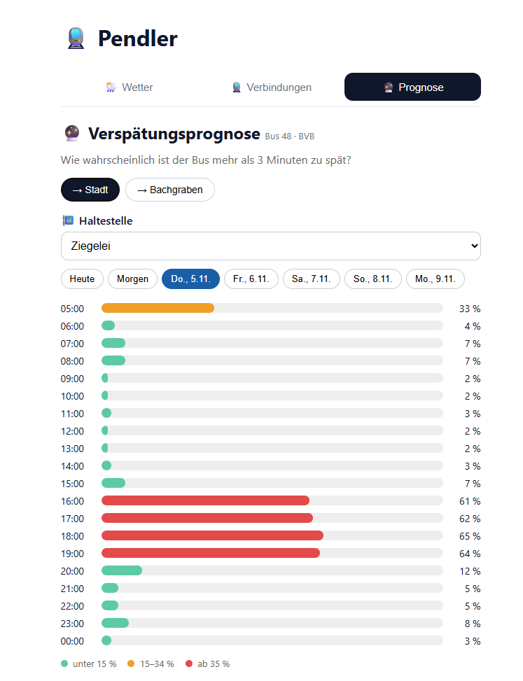
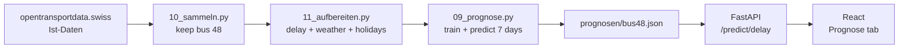

# 🚆 Pendler

**A daily dashboard for commuters in Switzerland.**
Open it in the morning and instantly see what you need for your day: the weather where you live, whether you need an umbrella, the next public holiday in your canton, your train, tram or bus connections – and how likely your bus is to be late.

**🌐 Live demo:** https://pendler.vercel.app/

<p align="center">
  
  
  
</p>

## ✨ Features

**🌦️ Weather**
- Search any town in Switzerland and pin your favourite places
- Current temperature, min/max and a "Do I need an umbrella?" check
- Hourly temperature and rain chart, plus a 7-day forecast
- 🌸 Pollen level for the selected place

**📅 Public holidays**
- Next public holiday for the selected canton, highlighted when it's today or tomorrow

**🚆 Connections**
- Pin your daily routes with a departure time (e.g. home → work at 07:00)
- See all connections for the next 3 hours, with platform, line, duration and delays
- Works for trains, trams and buses (🚆 🚋 🚌)
- "Now" button to see connections leaving right away

**🔮 Delay forecast (Machine Learning)**
- Probability that bus 48 (BVB, Basel) is more than 3 minutes late
- Per stop, direction and hour for the next 7 days, with colour-coded risk (🟢 low · 🟠 medium · 🔴 high)
- Retrained automatically every night with the latest data

**📱 Made for mobile**
- Responsive layout with a bottom navigation bar on phones
- Your pins and settings are saved in your browser – no account needed

## 🛠️ Tech Stack

| Part | Technology |
|---|---|
| Frontend | React, Vite, Recharts |
| Backend | Python, FastAPI |
| Data Science | pandas, scikit-learn, matplotlib, Jupyter |
| MLOps | GitHub Actions (nightly data collection, training and forecast) |
| Testing | pytest |
| Data | Open-Meteo, OpenHolidays API, transport.opendata.ch, opentransportdata.swiss, MeteoSwiss |
| Hosting | Vercel (frontend and backend as two projects) |
| Project management | Scrum with GitHub Issues, Milestones and a Project Board |

## 🏗️ Architecture

```
React frontend (Vercel)  →  FastAPI backend (Vercel)  →  Open-Meteo
                                                      →  OpenHolidays API
                                                      →  transport.opendata.ch
                                                      →  prognosen/bus48.json  ← GitHub Actions (nightly)
```

The frontend never talks to the data sources directly. The backend fetches the raw data, cleans it up and returns simple JSON. The delay forecast is computed in advance every night (batch prediction), so the API only has to read a file – fast and free to host.

## 🔮 Delay Prediction (Machine Learning)

A model predicts the **risk that bus 48 in Basel is more than 3 minutes late**. It is trained on 3 months of real operational data (Ist-Daten from opentransportdata.swiss, ~184'000 measured departures), combined with hourly weather from MeteoSwiss and school holidays.

| Model | AUC | Brier score |
|---|---|---|
| Baseline (average per hour & direction) | 0.79 | 0.121 |
| **Gradient Boosting** | **0.81** | **0.109** |
| Gradient Boosting + 7-day trend feature | 0.80 | 0.110 |

**What I learned**
- Predicting the *minutes* of delay barely beat the baseline (MAE 1.28 vs 1.33 min) – most delay is random.
- Predicting the *risk* of a delay works much better, and the probabilities are well calibrated: when the model says 30 %, about 30 % of buses are actually late.
- A trend feature (share of late buses in the last 7 days) made the model slightly worse – too few buses per hour make it noisy. Decision: keep the simpler model.
- Evaluation uses a time-based split (train on the past, test on the most recent week), so the model never sees the future.

Notebooks: [`ml/05_delay_explore`](ml/05_delay_explore.ipynb) · [`ml/06_delay_prepare`](ml/06_delay_prepare.ipynb) · [`ml/07_delay_model`](ml/07_delay_model.ipynb) · [`ml/08_delay_risk`](ml/08_delay_risk.ipynb)

## ⚙️ MLOps Pipeline

Every night a GitHub Actions workflow collects new data, retrains the model and publishes a fresh forecast – no manual steps.



Workflow: [`.github/workflows/nacht.yml`](.github/workflows/nacht.yml) · runs daily at 04:17 UTC · the API token is stored as a GitHub Secret.

## 📊 Data Science: Bikes in Basel

A first practice project before the delay model: predicting daily bike traffic in Basel.

- ~600'000 hourly bike counts (data.bs.ch) combined with daily weather from MeteoSwiss
- Insight: about 70 % more bikes on weekdays than on weekends; temperature and sunshine matter more than rain
- Model: R² 0.83 – the error was roughly halved compared to a simple baseline (MAE 4'531 vs 8'308 bikes per day)

Notebooks: [`ml/02_explore`](ml/02_explore.ipynb) · [`ml/03_model`](ml/03_model.ipynb)

## 🔌 API Endpoints

| Endpoint | Description |
|---|---|
| `GET /weather/today` | Today's weather with hourly temperature and rain probability |
| `GET /weather/week` | 7-day forecast with weather code, min/max and rain probability |
| `GET /locations/search` | Search Swiss towns (incl. canton) |
| `GET /pollen` | Pollen level for a location |
| `GET /holidays/next` | Next public holiday for a canton |
| `GET /stations/search` | Search stations and stops |
| `GET /connections` | Connections between two stops for the next 3 hours |
| `GET /predict/delay/stops` | Stops of bus 48 per direction |
| `GET /predict/delay?haltestelle=Ziegelei&richtung=stadteinwärts` | Delay risk per hour for the next 7 days |
| `GET /docs` | Interactive API documentation |

## 🚀 Getting Started

**Backend**

```bash
# 1. Clone the repository
git clone https://github.com/SJC929/Pendler.git
cd Pendler

# 2. Create and activate a virtual environment (Windows)
python -m venv .venv
.venv\Scripts\Activate.ps1

# 3. Install dependencies
python -m pip install -r requirements.txt

# 4. Start the API
python -m uvicorn main:app --reload
```

The API runs on http://127.0.0.1:8000 (docs: http://127.0.0.1:8000/docs).

**Frontend** (in a second terminal)

```bash
cd frontend
npm install
npm run dev
```

Then open http://localhost:5173 in your browser.

**Tests and data science** (optional)

```bash
python -m pip install -r requirements-dev.txt
python -m pytest
```

## 🗺️ Roadmap

- [x] Weather for today and the week
- [x] React web interface with chart and 7-day view
- [x] Deploy to Vercel
- [x] Search and pin your own places
- [x] Pollen level
- [x] Public holidays per canton
- [x] Train, tram and bus connections
- [x] Mobile layout with tab navigation
- [x] Better error handling when a data source is unavailable
- [x] Automated tests with pytest
- [x] Collect delay data and analyse it with pandas
- [x] Delay risk prediction for bus 48 + nightly MLOps pipeline
- [ ] Delay prediction for all tram and bus lines in Basel, shown directly next to each connection
- [ ] Extend to Zurich, Bern and Winterthur
- [ ] Rain warning at commute time
- [ ] Traffic prediction with ASTRA traffic counters
- [ ] TypeScript and Docker

Progress is tracked on the [project board](https://github.com/SJC929/Pendler/issues).

## 📄 License & Credits

- Code: MIT License
- Weather, pollen and location data by [Open-Meteo.com](https://open-meteo.com/) (CC BY 4.0)
- Public holidays by [OpenHolidays API](https://www.openholidaysapi.org/) (CC BY 4.0)
- Timetable data by [transport.opendata.ch](https://transport.opendata.ch/) (Swiss public transport open data)
- Actual public transport data (Ist-Daten) by [opentransportdata.swiss](https://opentransportdata.swiss/)
- Historical weather by [MeteoSwiss Open Data](https://www.meteoswiss.admin.ch/)
- Bike counts by [data.bs.ch](https://data.bs.ch/) (Kanton Basel-Stadt)