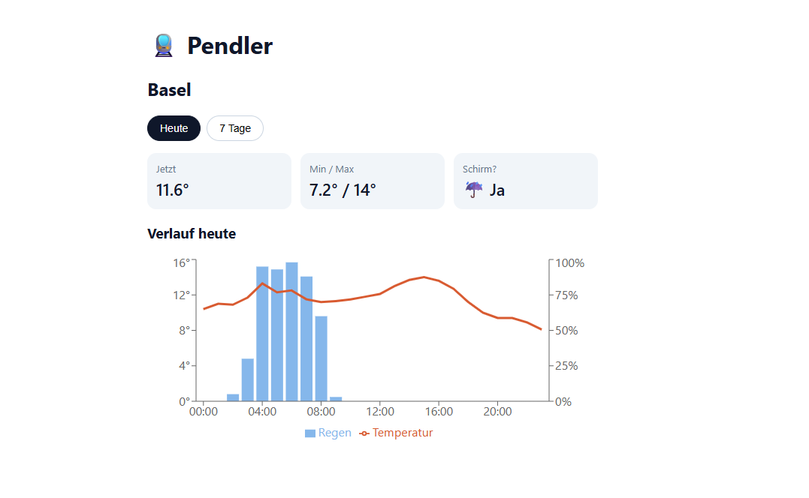

# 🚆 Pendler

**A daily dashboard for commuters in Switzerland.**
Open it in the morning and instantly see what you need for your day: today's weather, the temperature curve and whether you need an umbrella.

> 🚧 Work in progress – backend and web interface are done, online deployment is coming next.



## ✨ Features

- 🌦️ Current weather and min/max temperature for today
- 📈 Hourly temperature and rain probability
- ☔ "Do I need an umbrella?" check
- 🗓️ 7-day forecast

## 🛠️ Tech Stack

| Part | Technology |
|---|---|
| Backend | Python, FastAPI |
| Weather data | [Open-Meteo API](https://open-meteo.com/) |
| Frontend | React, Recharts |
| Hosting (planned) | Vercel |

## 🔌 API Endpoints

| Endpoint | Description |
|---|---|
| `GET /weather/today` | Today's weather with hourly temperature and rain probability |
| `GET /weather/week` | 7-day forecast with weather code, min/max and rain probability |
| `GET /docs` | Interactive API documentation |

## 🚀 Getting Started

```bash
# 1. Clone the repository
git clone https://github.com/SJC929/Pendler.git
cd Pendler

# 2. Create and activate a virtual environment (Windows)
python -m venv .venv
.venv\Scripts\Activate.ps1

# 3. Install dependencies
python -m pip install -r requirements.txt

# 4. Start the server
python -m uvicorn main:app --reload
```

Then open http://127.0.0.1:8000/docs in your browser.

## 🗺️ Roadmap

- [x] Fetch weather data for Basel
- [x] FastAPI endpoints for today and the week
- [x] React web interface (today view + 7-day view)
- [ ] Deploy to Vercel
- [ ] Choose your own city
- [ ] Train connections (SBB)

Progress is tracked on the [project board](https://github.com/SJC929/Pendler/issues).

## 📄 License & Credits

- Code: MIT License
- Weather data by [Open-Meteo.com](https://open-meteo.com/) (CC BY 4.0)