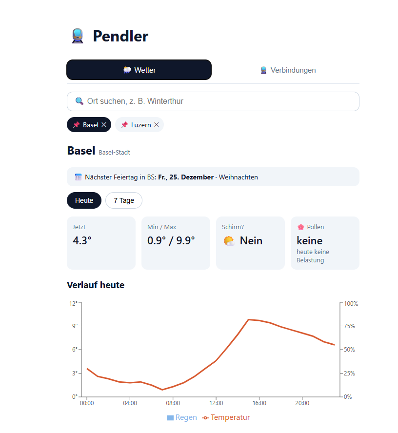
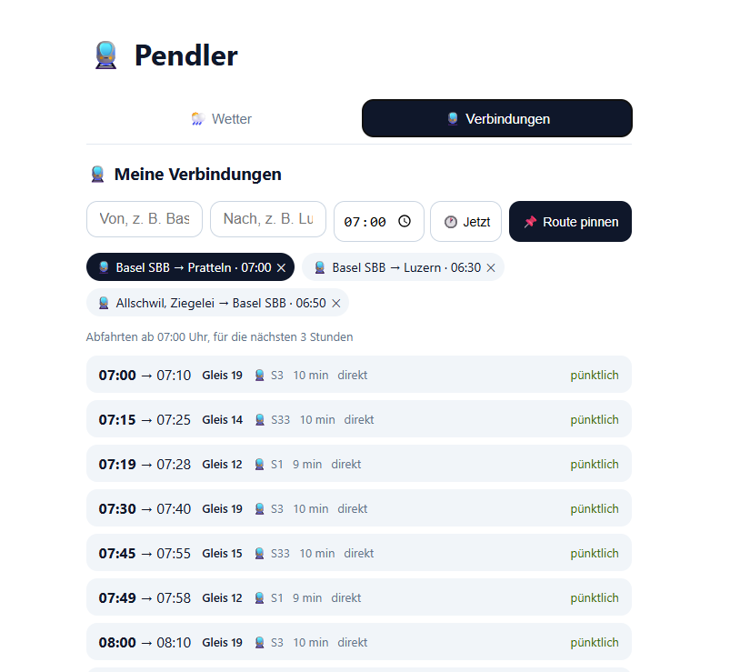

# 🚆 Pendler

**A daily dashboard for commuters in Switzerland.**
Open it in the morning and instantly see what you need for your day: the weather where you live, whether you need an umbrella, the next public holiday in your canton and your train, tram or bus connections.

**🌐 Live demo:** https://pendler.vercel.app/

<p align="center">
  
  
</p>

## ✨ Features

**🌦️ Weather**
- Search any town in Switzerland and pin your favourite places
- Current temperature, min/max and an "Do I need an umbrella?" check
- Hourly temperature and rain chart, plus a 7-day forecast
- 🌸 Pollen level for the selected place

**📅 Public holidays**
- Next public holiday for the selected canton, highlighted when it's today or tomorrow

**🚆 Connections**
- Pin your daily routes with a departure time (e.g. home → work at 07:00)
- See all connections for the next 3 hours, with platform, line, duration and delays
- Works for trains, trams and buses (🚆 🚋 🚌)
- "Now" button to see connections leaving right away

**📱 Made for mobile**
- Responsive layout with a bottom navigation bar on phones
- Your pins are saved in your browser – no account needed

## 🛠️ Tech Stack

| Part | Technology |
|---|---|
| Frontend | React, Vite, Recharts |
| Backend | Python, FastAPI |
| Data | Open-Meteo, OpenHolidays API, transport.opendata.ch |
| Hosting | Vercel (frontend and backend as two projects) |
| Project management | Scrum with GitHub Issues, Milestones and a Project Board |

## 🏗️ Architecture

```
React frontend (Vercel)  →  FastAPI backend (Vercel)  →  Open-Meteo
                                                      →  OpenHolidays API
                                                      →  transport.opendata.ch
```

The frontend never talks to the data sources directly. The backend fetches the raw data, cleans it up and returns simple JSON.

## 🔌 API Endpoints

| Endpoint | Description |
|---|---|
| `GET /weather/today` | Today's weather with hourly temperature and rain probability |
| `GET /weather/week` | 7-day forecast with weather code, min/max and rain probability |
| `GET /locations/search` | Search Swiss towns (incl. canton) |
| `GET /pollen` | Pollen level for a location |
| `GET /holidays/next` | Next public holiday for a canton |
| `GET /stations/search` | Search stations and stops |
| `GET /connections` | Connections between two stops for the next 3 hours |
| `GET /docs` | Interactive API documentation |

## 🚀 Getting Started

**Backend**

```bash
# 1. Clone the repository
git clone https://github.com/SJC929/Pendler.git
cd Pendler

# 2. Create and activate a virtual environment (Windows)
python -m venv .venv
.venv\Scripts\Activate.ps1

# 3. Install dependencies
python -m pip install -r requirements.txt

# 4. Start the API
python -m uvicorn main:app --reload
```

The API runs on http://127.0.0.1:8000 (docs: http://127.0.0.1:8000/docs).

**Frontend** (in a second terminal)

```bash
cd frontend
npm install
npm run dev
```

Then open http://localhost:5173 in your browser.

## 🗺️ Roadmap

- [x] Weather for today and the week
- [x] React web interface with chart and 7-day view
- [x] Deploy to Vercel
- [x] Search and pin your own places
- [x] Pollen level
- [x] Public holidays per canton
- [x] Train, tram and bus connections
- [x] Mobile layout with tab navigation
- [ ] Better error handling when a data source is unavailable
- [ ] "When do I need to leave?" countdown
- [ ] Collect delay data and analyse it with pandas

Progress is tracked on the [project board](https://github.com/SJC929/Pendler/issues).

## 📄 License & Credits

- Code: MIT License
- Weather, pollen and location data by [Open-Meteo.com](https://open-meteo.com/) (CC BY 4.0)
- Public holidays by [OpenHolidays API](https://www.openholidaysapi.org/) (CC BY 4.0)
- Timetable data by [transport.opendata.ch](https://transport.opendata.ch/) (Swiss public transport open data)